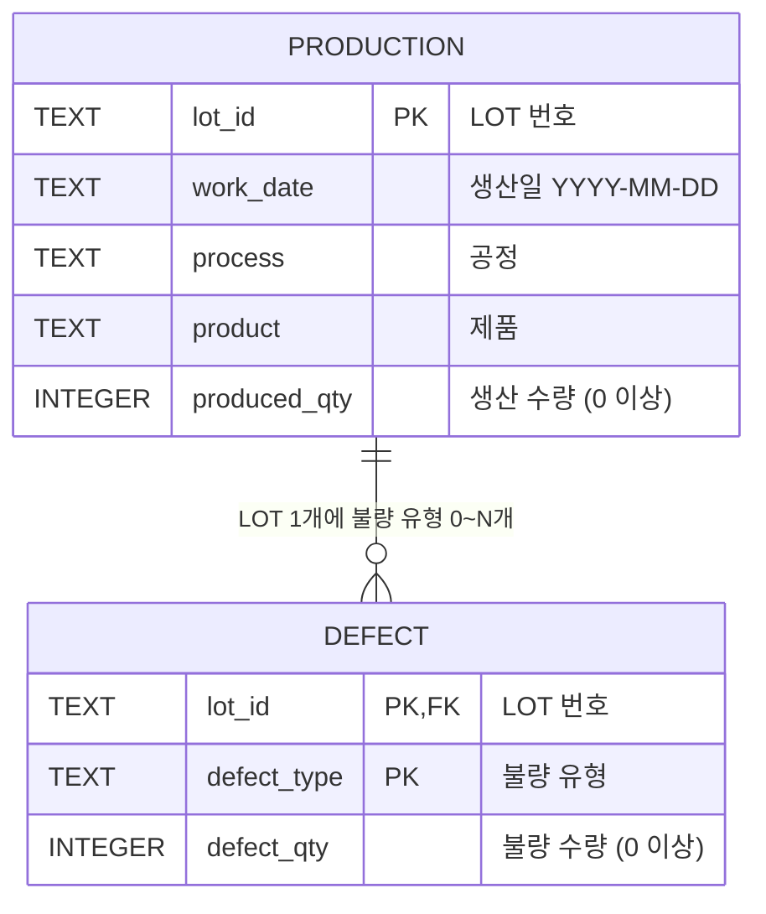

# ERD와 스키마

## 관계도



- `production` 1행 = LOT 1개
- `defect` 1행 = LOT 1개 × 불량 유형 1개
- 불량이 없는 LOT는 `defect`에 행이 없습니다(0..N 관계). 집계할 때 LEFT JOIN으로 불량 0으로 처리합니다.

## 스키마 (`factorylens/db.py`)

```sql
CREATE TABLE production (
    lot_id       TEXT PRIMARY KEY,
    work_date    TEXT NOT NULL,
    process      TEXT NOT NULL,
    product      TEXT NOT NULL,
    produced_qty INTEGER NOT NULL CHECK (produced_qty >= 0)
);

CREATE TABLE defect (
    lot_id      TEXT NOT NULL REFERENCES production(lot_id),
    defect_type TEXT NOT NULL,
    defect_qty  INTEGER NOT NULL CHECK (defect_qty >= 0),
    PRIMARY KEY (lot_id, defect_type)
);

CREATE INDEX idx_production_date ON production(work_date);
```

## 설계 이유

| 결정 | 이유 |
|---|---|
| 테이블 2개로 분리 | 한 테이블에 LOT×불량유형 행을 두면 생산량이 행마다 반복되어 합산할 때 중복 집계될 위험이 있습니다. 분리하면 생산량은 LOT당 한 번만 저장됩니다. |
| `defect`의 PK = (lot_id, defect_type) | 같은 LOT의 같은 불량 유형은 1행이어야 합니다. 중복은 업로드 단계에서 먼저 처리합니다(D1·D2 규칙). |
| 날짜를 TEXT `YYYY-MM-DD`로 저장 | SQLite에는 날짜 타입이 없습니다. 이 형식은 문자열 비교 순서와 날짜 순서가 같아서 `BETWEEN`이나 `>=`로 범위를 검색할 수 있습니다. |
| 공정·제품 마스터 테이블 없음 | MVP 범위에서는 코드값 목록 관리가 필요 없습니다(과설계 방지). |
| PK·CHECK·FK 제약 | Python 검증이 1차 방어선이고, DB 제약은 검증 코드에 버그가 있을 때를 대비한 2차 방어선입니다. SQLite는 FK 검사가 기본으로 꺼져 있어 `PRAGMA foreign_keys = ON`을 실행합니다. |
| 인메모리 DB, 업로드마다 교체 | 공개 배포 환경에서 사용자 간 데이터가 섞이지 않고 서버 디스크에도 남지 않습니다. 이전 업로드와의 중복 문제도 생기지 않습니다. |
