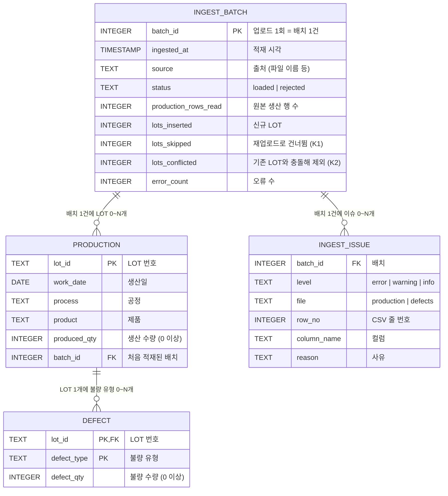

# ERD와 스키마

## 관계도



- `production` 1행 = LOT 1개, `defect` 1행 = LOT 1개 × 불량 유형 1개
- 불량이 없는 LOT는 `defect`에 행이 없습니다(0..N 관계). 집계할 때 LEFT JOIN으로 불량 0으로 처리합니다.
- `ingest_batch`는 업로드 1회의 결과 요약, `ingest_issue`는 그 업로드에서 제외·경고된 행과 사유입니다. 파일이 거부된 업로드도 `status = 'rejected'`로 남습니다.
- 표의 타입은 PostgreSQL 기준입니다. 일부 컬럼(`defect_rows_read`, `defect_rows_inserted`, `warning_count`)은 그림에서 생략했습니다.

## 스키마

전체 DDL은 `factorylens/db.py`에 있습니다. 두 DB에 같은 구조로 만들고, 타입만 DB에 맞춥니다.

| 항목 | SQLite (데모 모드, 로컬 파일) | PostgreSQL (누적 모드) |
|---|---|---|
| `work_date` | `TEXT` ('YYYY-MM-DD') | `DATE` |
| `batch_id` | `INTEGER PRIMARY KEY` (자동 증가) | `BIGINT GENERATED ALWAYS AS IDENTITY` |
| `ingested_at` | `TEXT` (ISO 8601, 시간대 포함) | `TIMESTAMPTZ` |
| 코드값 정렬 | 바이트 순서 (기본) | `COLLATE "C"`로 SQLite와 같은 순서 |
| FK 검사 | `PRAGMA foreign_keys = ON` 필요 | 기본으로 켜짐 |

```sql
-- PostgreSQL (발췌)
CREATE TABLE production (
    lot_id       TEXT COLLATE "C" PRIMARY KEY,
    work_date    DATE NOT NULL,
    process      TEXT COLLATE "C" NOT NULL,
    product      TEXT COLLATE "C" NOT NULL,
    produced_qty INTEGER NOT NULL CHECK (produced_qty >= 0),
    batch_id     BIGINT REFERENCES ingest_batch(batch_id)
);

CREATE TABLE defect (
    lot_id      TEXT COLLATE "C" NOT NULL REFERENCES production(lot_id),
    defect_type TEXT COLLATE "C" NOT NULL,
    defect_qty  INTEGER NOT NULL CHECK (defect_qty >= 0),
    PRIMARY KEY (lot_id, defect_type)
);

CREATE INDEX idx_production_date ON production(work_date);
CREATE INDEX idx_issue_batch ON ingest_issue(batch_id);
```

## 설계 이유

| 결정 | 이유 |
|---|---|
| 생산·불량 테이블 분리 | 한 테이블에 LOT×불량유형 행을 두면 생산량이 행마다 반복되어 합산할 때 중복 집계될 위험이 있습니다. 분리하면 생산량은 LOT당 한 번만 저장됩니다. |
| `defect`의 PK = (lot_id, defect_type) | 같은 LOT의 같은 불량 유형은 1행이어야 합니다. 중복은 업로드 단계에서 먼저 처리합니다(D1·D2 규칙). |
| 적재 이력 테이블 2개 (`ingest_batch`, `ingest_issue`) | 누적 DB에서는 "이 숫자에 어떤 업로드가 들어갔고, 무엇이 왜 빠졌는가"에 답할 수 있어야 합니다. 화면의 오류 목록은 닫으면 사라집니다. |
| `production.batch_id` | LOT마다 처음 적재된 배치를 남겨, 잘못 올린 업로드를 찾아 되돌릴 때 범위를 알 수 있습니다. 재업로드로 건너뛴 LOT는 원래 배치 번호를 유지합니다. |
| 기존 LOT를 덮어쓰지 않음 | 덮어쓰면 이전 값이 사라져 추적이 불가능합니다. 내용이 다른 재업로드는 제외하고 사유를 남깁니다(K2). |
| PostgreSQL 날짜는 `DATE` | 잘못된 날짜를 DB가 거부하고, 날짜 함수를 쓸 수 있습니다. SQLite에는 날짜 타입이 없어 `YYYY-MM-DD` 문자열로 저장하며, 이 형식은 문자열 순서와 날짜 순서가 같아 `BETWEEN`·`>=`로 범위를 검색할 수 있습니다. |
| 공정·제품 마스터 테이블 없음 | 현재 범위에서는 코드값 목록 관리가 필요 없습니다(과설계 방지). |
| PK·CHECK·FK 제약 | Python 검증이 1차 방어선이고, DB 제약은 검증 코드에 버그가 있을 때를 대비한 2차 방어선입니다. 제약 위반이 나면 배치 전체가 롤백됩니다. |
| 데모 모드는 인메모리 DB, 업로드마다 교체 | 공개 배포 환경에서 사용자 간 데이터가 섞이지 않고 서버 디스크에도 남지 않습니다. |
